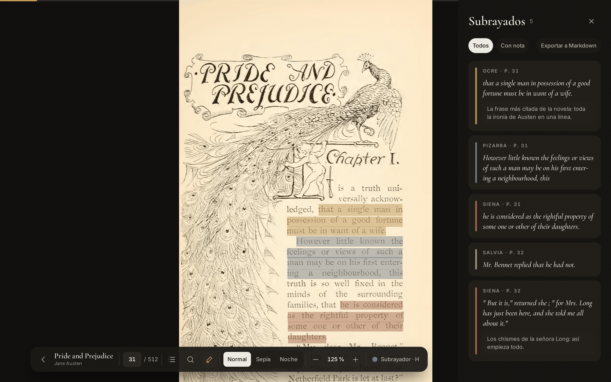
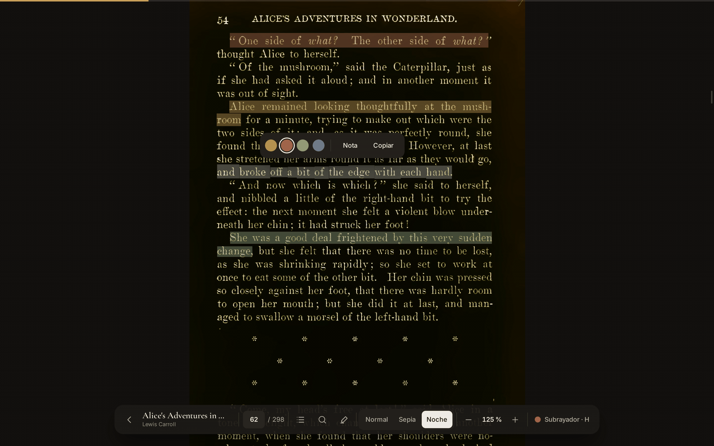
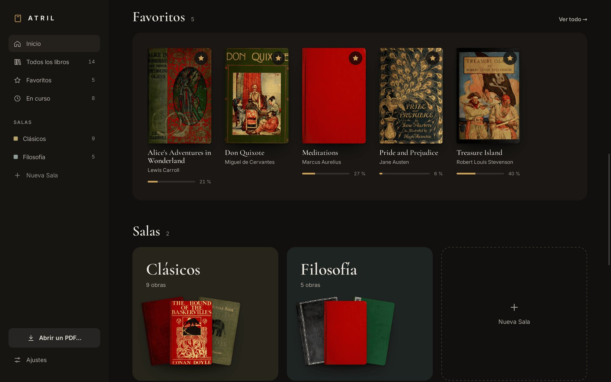
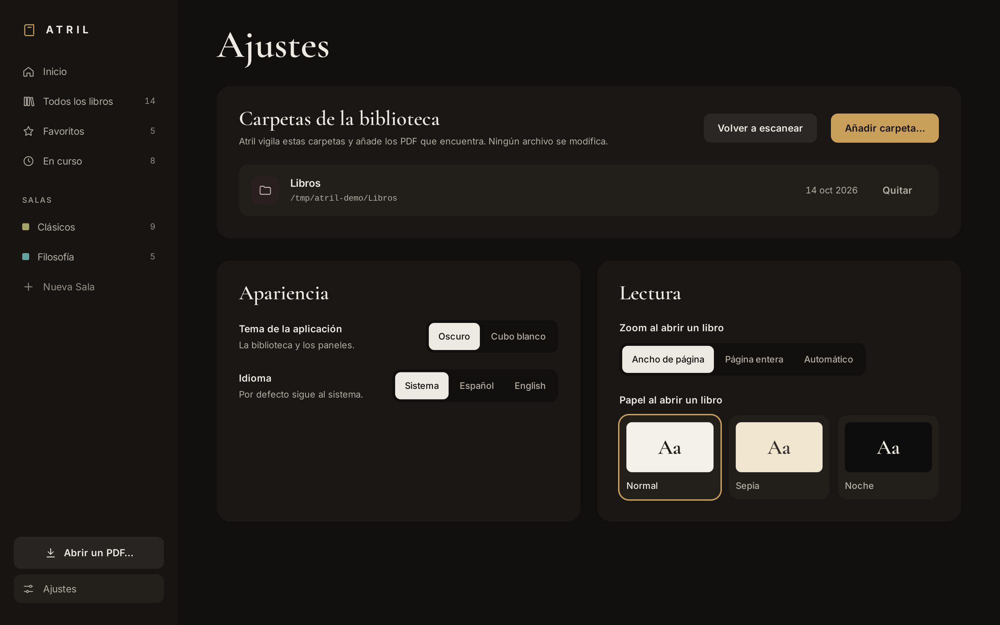

<div align="center">


# Atril

**A quiet desktop reader for your PDF books, with a library at its heart.**

[](https://github.com/GabJS10/atril/actions/workflows/ci.yml)
[](https://github.com/GabJS10/atril/releases/latest)
[](LICENSE)


[Download](#install) · [Features](#features) · [Screenshots](#screenshots) · [Build from source](#build-from-source) · [Changelog](CHANGELOG.md)

</div>

---

<p align="center">
  
</p>

*Atril* is Spanish for *lectern*: the stand that holds a book open while you read. The app does the same for the PDFs you read as books. It opens straight into your library, remembers the exact spot where you stopped in every book, and saves your highlights the moment you make them, without ever touching the original files.

It is a reader for your books, not a generic PDF viewer: you add a folder (or a single PDF) from inside the app, and Atril takes care of the rest.

## Features

### A library first
- **Continue reading** right where you left off, with the card tinted by the book's own cover.
- **Favorites** and **rooms**: your own collections, each with its color.
- **Watched folders**: new PDFs in them appear on their own. You can also open a single PDF or drop it on the window.
- **Search** by title or author (<kbd>Ctrl</kbd>+<kbd>K</kbd>), with filters by reading status and several sort orders.
- Books are recognized **by their content**, so moving or renaming a file keeps its progress, highlights and rooms.

### A reader that stays out of the way
- **Native PDF engine** (MuPDF): fast first page, smooth scrolling and crisp zoom, scanned books included.
- **Remembers the exact position** in every book, down to the scroll offset.
- **Highlights in four pigments**, with notes, saved instantly and **exportable to Markdown**. Your PDF files are never modified.
- **Search** with highlighted matches (<kbd>Ctrl</kbd>+<kbd>F</kbd>), **outline**, and working **links**.
- **Normal, sepia and night** paper, focus mode (<kbd>F</kbd>) and full screen (<kbd>F11</kbd>).

### Made to feel calm
- A "gallery at night" design, in **dark** and **light** themes.
- Interface in **English and Spanish**, following your system language.
- Everything stays on your machine: no accounts, no network, no telemetry.

## Screenshots

<table>
  <tr>
    <td width="50%"><br><sub><b>Reading.</b> Highlights in four pigments, with notes, and a toolbar that hides while you read.</sub></td>
    <td width="50%"><br><sub><b>Night paper.</b> Also sepia. Select text to highlight, add a note or copy it.</sub></td>
  </tr>
  <tr>
    <td width="50%"><br><sub><b>Favorites and rooms.</b> Your own collections, each with its color.</sub></td>
    <td width="50%"><br><sub><b>A room.</b> Filter by status and sort as you like.</sub></td>
  </tr>
  <tr>
    <td width="50%"><br><sub><b>Light theme.</b> "White cube", for daytime.</sub></td>
    <td width="50%"><br><sub><b>Settings.</b> Folders, theme, language and reading defaults.</sub></td>
  </tr>
</table>

<sub>The books in the screenshots are public-domain editions from the Internet Archive (sources in <a href="docs/screenshots/README.md">docs/screenshots</a>).</sub>

## Install

Atril runs on **Linux** and **Windows 10/11** (x86-64). Get the files from the [latest release](https://github.com/GabJS10/atril/releases/latest).

**Windows** (`.exe` installer): run `Atril_1.1.0_x64-setup.exe`. It installs for your user only, without administrator rights. The installer is not signed yet, so Windows SmartScreen may warn you: click **More info → Run anyway**. Atril needs Microsoft Edge WebView2, which Windows 10/11 usually has; if not, the installer downloads it. To uninstall: *Settings → Apps*.

**Debian, Ubuntu, Linux Mint** (`.deb`):

```bash
sudo apt install ./atril-libros_1.1.0_amd64.deb
```

**Any distribution** (AppImage):

```bash
chmod +x atril-libros_1.1.0_amd64.AppImage
./atril-libros_1.1.0_amd64.AppImage
```

> The package and the command are called `atril-libros`, so they never clash with the unrelated *Atril* document viewer of the MATE desktop (package `atril`). In your menu the app is simply called **Atril**.

To uninstall the `.deb`: `sudo apt remove atril-libros`. Your library is kept.

### Where your data lives
Atril never modifies or moves your PDFs. Your library, reading positions, highlights and covers are stored in `~/.local/share/atril/` on Linux and `%LOCALAPPDATA%\atril\` on Windows (`atril.db`, `covers/` and the log, `atril.log`). Uninstalling Atril keeps this folder, so a reinstall finds your library as you left it; delete the folder to start from scratch.

## Build from source

You need Node.js 24, Rust (stable) and the Tauri system dependencies. On Ubuntu or Linux Mint:

```bash
sudo apt install libwebkit2gtk-4.1-dev build-essential libssl-dev librsvg2-dev \
  libayatana-appindicator3-dev libxdo-dev libclang-dev
```

Then:

```bash
npm install
npm run tauri dev                              # run in development
npm run tauri build -- --bundles deb,appimage  # build the packages
```

MuPDF is compiled from source on the first build, which takes a few minutes. Without `libclang-dev` (no sudo), run `. src-tauri/scripts/libclang-env.sh` in the same shell first.

Checks:

```bash
npm run lint && npm run typecheck && npm test
cd src-tauri && cargo fmt --check && cargo clippy --all-targets -- -D warnings && cargo test
```

## How it is built

| | |
|---|---|
| **App shell** | [Tauri 2](https://tauri.app) |
| **Interface** | React 19, TypeScript, Vite, Tailwind 4, TanStack Router and Query |
| **Core** | Rust: SQLite (`rusqlite`), folder watching (`notify`), the `atril://` protocol |
| **PDF engine** | [MuPDF](https://mupdf.com), rendering pages to images in a background pool |

Architecture notes, the frontend ⇄ backend contract and the design system live in [`docs/`](docs/) and [`DESIGN.md`](DESIGN.md). The project documentation is in Spanish.

## License

Copyright (C) 2026 GabJS10.

Atril is free software, licensed under the [GNU Affero General Public License v3.0](LICENSE). It links [MuPDF](https://mupdf.com), which is AGPL-3.0 too.
